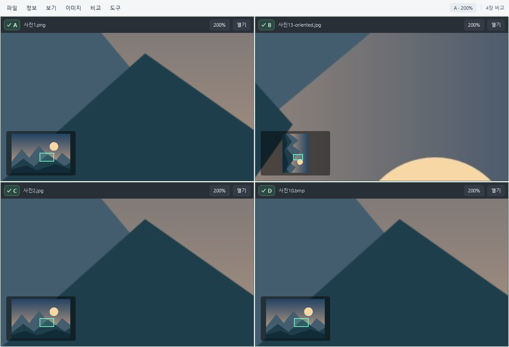

# 키나뷰 0.4.3

Windows용 독립 이미지 뷰어입니다. 사진, GIF/WebP 애니메이션, RAW, PSD와 HDR을 열고 최대4장을 나란히 비교할 수 있습니다. 원본 파일은 수정하지 않습니다.



## 다운로드 및 설치

[최신 릴리스](https://github.com/DAMKINA00/KinaView/releases/latest)에서 내려받으세요.

- `KinaView-0.4.3-Setup-x64.exe`: Windows x64 설치 프로그램. 현재 사용자에게 설치하며 관리자 권한과 별도 .NET 설치가 필요하지 않습니다. 탐색기 연동과 바탕 화면 바로가기는 설치 옵션입니다.
- `KinaView-0.4.3-Portable-x64.zip`: 압축을 모두 풀고 `KinaView.exe`를 실행합니다. .NET 실행 환경과 만화 보기 모델이 포함되어 있습니다.
- `SHA256SUMS.txt`: 배포 파일의 SHA-256 체크섬입니다.

설치본은 Windows의 설치된 앱에서 제거할 수 있습니다. 설치/제거는 다른 앱의 기본 연결 설정을 변경하지 않습니다. 설치 파일은 코드 서명되지 않았으므로 Windows에서 게시자 확인 경고가 나타날 수 있습니다.

Windows10/11 x64 대상입니다. 실제 검증 환경은 Windows11 x64입니다. ARM64 및 이전 Windows는 검증하지 않았습니다.

## 지원 기능

- GIF·애니메이션 WebP 자동 반복 재생. Space로 일시 정지/재개. 부분 프레임, 투명도, disposal 및 프레임별 지연 처리.
- RAW / DNG: LibRaw 현상. CR2/CR3/CRW, NEF/NRW, ARW/SR2/SRF, RAF, RW2, ORF, PEF, SRW 등. 카메라/압축 변형별 지원은 포함된 LibRaw에 따라 다릅니다.
- PSD / PSB: 저장된 합성 이미지 표시. 레이어 편집은 지원하지 않습니다.
- HDR / EXR: 부동소수 밝기를 Reinhard 곡선과 sRGB 전달 함수로 SDR 톤 매핑. 실제 HDR 모니터 고휘도 출력과 Ultra HDR 게인맵 재현은 이번 범위 밖입니다.
- JPG, PNG, BMP, TIFF, ICO, WebP, HEIC, AVIF. WebP/HEIC/AVIF는 내장 디코더 사용. TIFF/ICO 및 GIF/WebP 이외 애니메이션은 첫 이미지 표시.

이미지당 최대 1억 픽셀. GIF/WebP 애니메이션은 완성 프레임의 BGRA 합계 128 MiB 및 2048 프레임까지 지원합니다. 초과하면 오류를 표시합니다. RAW는 별도 메모리 한도로 열기에 실패할 수 있습니다. GIF/WebP는 파일의 유한 반복 횟수와 관계없이 반복합니다.

## 만화 보기

보기 → 만화 보기 또는 Ctrl+M으로 켭니다. 이미지 비율을 유지하면서 현재 창에 최대한 맞춥니다. 작은 이미지 확대와 큰 이미지 축소 모두 표시용 비트맵을 다시 만듭니다. 원본 파일과 해상도는 변경하거나 저장하지 않습니다. 비교 보기에도 적용됩니다.

정지 이미지 확대에는 만화·애니메이션용 경량 모델 [Real-ESRGAN AnimeVideo v3](https://github.com/xinntao/Real-ESRGAN/blob/master/docs/anime_video_model.md)를 사용합니다. 2/3/4배 AI 보정 후 창 크기에 맞춰 Lanczos 리샘플링합니다. 축소와 GIF/WebP 재생 중에는 Lanczos를 사용합니다. 모델은 앱에 포함되며 로컬 GPU에서 처리합니다. 이미지가 외부 서버로 전송되지 않습니다.

GPU 보정 중에도 원래 이미지를 먼저 표시하며 탐색·창 크기 변경·모드 해제 시 이전 요청을 취소합니다. Vulkan GPU를 사용할 수 없거나 AI 처리에 실패하면 Lanczos로 표시하고 상태를 알립니다. 표시용 비트맵은 1600만 픽셀·한 변 16000픽셀, AI 중간 결과는 3200만 픽셀로 제한합니다. 이 한도를 넘는 AI 보정은 Lanczos로 처리합니다. 만화 보기의 창 맞춤은 일반 보기의 1600% 확대 제한을 적용하지 않습니다.

## 화면과 속도

상단36px 메뉴 한 줄과 이미지 영역. 파일 목록은 기본 숨김이며 Ctrl+B로 표시합니다. Tab은 파일 정보 오버레이를 켜고 끕니다. F11 전체화면에서는 메뉴와 파일 목록도 숨깁니다.

선택한 이미지를 먼저 표시한 뒤 폴더 목록을 읽습니다. 최근3장까지 최대192 MiB의 디코딩 결과를 보관하며 크기·수정 시각 변경이나 삭제 시 재사용하지 않습니다. OpenMP 빌드와 HDR 톤 매핑이 최대4개 CPU 작업자를 사용합니다. JPG/PNG의 Windows 디코더나 RAW 라이브러리의 직렬 구간까지 모두 병렬화되는 것은 아닙니다.

## 비교와 미니맵

비교 → A | B 비교 시작. 각 패널의 열기 버튼 또는 드래그 앤 드롭으로 파일을 따로 엽니다. 패널 추가로 C·D까지 늘립니다. 2·3장은 가로 배치, 4장은 2×2 배치입니다. 비교 화면에 여러 파일을 끌어 놓으면 최대4장을 A부터 채웁니다.

A·B·C·D 옆 체크 표시는 함께 조작할 패널입니다. 체크된 패널에서 휠, +/- 또는 0을 누르면 동일한 단계별 배율을 적용합니다. 마우스 드래그와 미니맵 이동은 이미지의 상대 중심 위치로 동기화합니다. 크기·종횡비가 다르거나 가장자리에 도달하면 각 이미지 경계 안에서 가능한 위치로 제한됩니다. 체크를 해제한 패널은 독립적으로 조작됩니다. 1 또는 패널 배율 버튼은 선택된 이미지가 모두 들어오는 공통 배율로 맞춥니다.

화면보다 큰 이미지는 왼쪽 아래에 미니맵과 현재 보이는 영역을 표시합니다. 미니맵 클릭·드래그 또는 초점을 둔 상태의 방향키로 이동할 수 있습니다. 줌은 10~200% 구간에서10% 단위, 200% 이상에서50% 단위로 이동합니다. 파일을 열 때는 화면에 정확히 들어오는 배율로 시작하며, 이때는 소수 배율을 허용합니다. 휠과 +/-로 그 배율을 지나갈 때 한 번 멈추고 다음 조작에서 기존 단계로 계속 이동합니다. 비교 모드에서 선택한 사진들은 모두 들어오는 공통 맞춤 배율에서 함께 멈춥니다. 일반 단계는10% 미만에서1% 단위를 사용합니다. 1%보다 작아야 들어가는 매우 큰 이미지는 소수 배율을 허용합니다. 작은 이미지도 화면에 맞게 확대하되 최대1600% 제한은 유지합니다. 정보 오버레이 배경 불투명도는44%입니다.

비교 모드에서는 파일 목록·슬라이드쇼 대신 각 패널의 파일 열기를 사용합니다. Esc 또는 비교 끝내기는 단일 보기로 돌아갑니다. F11 전체화면에서도 비교와 미니맵을 사용할 수 있습니다. 비교 패널은 현재 이미지만 보관하고 기존 디코딩 큐를 공유해 동시 디코딩의 메모리 폭증을 제한합니다.

## 조작

Ctrl+O 파일 열기 / Ctrl+Shift+O 폴더 열기 / 방향키 및 PageUp·PageDown 이전·다음 / Home·End 첫·마지막.
휠 또는 +/- 확대·축소 / 마우스로 끌기 이동 / 1 화면 맞춤 / 0 실제 픽셀 100% / R 회전.
F11 또는 더블클릭 전체화면 / F5 슬라이드쇼 / Esc 슬라이드쇼·전체화면 종료 / Space GIF/WebP 재생·정지.
Ctrl+M 만화 보기 / Ctrl+B 파일 목록 / Ctrl+C 현재 프레임 복사(보기 회전 제외) / Ctrl+Enter 파일 위치 / F1 도움말.

## 탐색기 연동

도구 메뉴에서 탐색기·연결 프로그램 등록 및 해제를 할 수 있습니다. 현재 사용자에게 지원 확장자의 '키나뷰로 열기', 연결 프로그램, Windows 기본 앱 후보를 추가합니다. Windows 11에서는 '더 많은 옵션 표시' 안에 나타날 수 있습니다.
기존 기본 앱과 UserChoice는 변경하지 않습니다. 기본 앱 변경은 도구 → Windows 기본 앱 설정 열기에서 직접 선택합니다.
CLI: KinaView.exe --register 또는 --unregister. 관리자 권한은 필요하지 않습니다.
등록 후 이미 열려 있던 우클릭 메뉴나 '연결 프로그램' 창은 닫고 다시 여세요. 등록 명령은 Windows에 변경 알림을 전달한 뒤 종료합니다.

## 개발 및 검증

Windows x64 및 .NET10 SDK가 필요합니다. Magick.NET-Q16-HDRI-OpenMP-x64 15.0.0 / ImageMagick / LibRaw를 사용합니다.

```powershell
git clone https://github.com/DAMKINA00/KinaView.git
cd KinaView
dotnet build -c Release
powershell -ExecutionPolicy Bypass -File scripts/Test.ps1
```

검사 스크립트는 공개 upstream CR2·DNG·PSD 샘플을 내려받아 SHA-256을 확인하고, 자체 GIF/WebP/HDR/EXR 및 격리된 임시 레지스트리로 검사합니다. 만화 보기의 확대·축소·전환·원본 보존·실제 GPU 보정도 검사하므로 Vulkan 지원 GPU가 필요합니다. 샘플 원본과 다운로드 주소는 `scripts/test-samples.json`에 있습니다. 결과와 UI 렌더는 Git에서 제외된 `evidence/` 폴더에 저장합니다. 테스트는 로컬 Windows 데스크톱 세션에서 실행해야 합니다.

AI 런타임과 모델은 `Runtime/RealESRGAN/`에 포함됩니다. 실행 파일과 모델을 다시 받으려면 `scripts/Install-ResizeModel.ps1`을 실행합니다. 고정된 공식 배포 파일의 SHA-256을 확인한 뒤 필요한 파일만 추출합니다. 출처·해시·라이선스는 `Runtime/RealESRGAN/PROVENANCE.md`에 있습니다.

설치 파일 빌드에는 [Inno Setup 6.7.3 이상](https://jrsoftware.org/isdl.php)이 추가로 필요합니다.

```powershell
powershell -ExecutionPolicy Bypass -File scripts/Build-Release.ps1 -Iscc "C:\Program Files (x86)\Inno Setup 6\ISCC.exe"
```

빌드 결과는 `artifacts/release/`에 생성됩니다. 오래된 파일이 섞이지 않도록 다시 빌드할 때는 기존 `artifacts/win-x64/`를 다른 위치로 옮긴 뒤 실행하세요. `--self-test <output-folder>`로 실행 파일을 직접 검사할 수도 있습니다.

## 타사 구성 요소

Magick.NET 및 관련 라이브러리 고지는 `ThirdPartyNotices.txt`, 배포에 포함된 .NET Runtime/WPF 고지는 `licenses/`, Real-ESRGAN 및 관련 구성 요소의 라이선스는 `Runtime/RealESRGAN/`에 있습니다. 프로젝트 자체에는 별도 재사용 라이선스를 아직 지정하지 않았습니다.

반디뷰 실행 파일·디코더·아이콘·소스를 포함하지 않습니다. 반디뷰의 모든 기능 또는 모든 RAW 변형과 동등함을 보장하지 않습니다.
